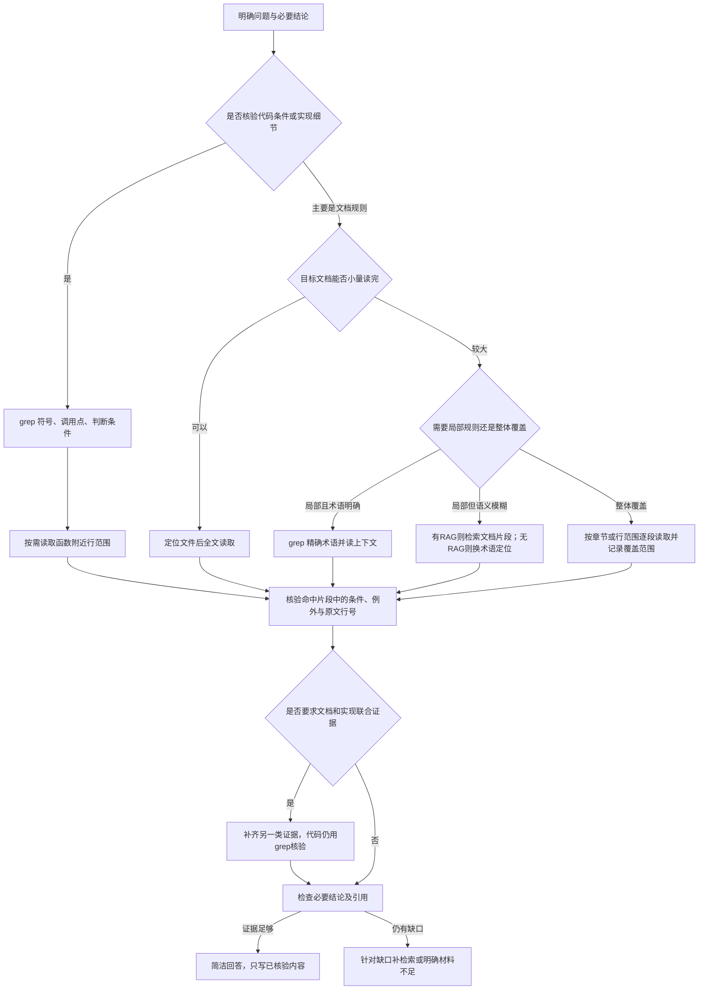

# 什么场景该用哪种检索方法

目标是用最少的相关上下文回答当前问题，并让结论能回到原始证据核验。工具选择由问题性质、材料大小、需要的范围共同决定。

| 场景 | 默认做法 | 结束条件 |
|---|---|---|
| 校验函数、参数、分支、锁、调用顺序 | grep源码；再读取小范围上下文 | 实际函数、条件及相关例外可核对 |
| 小文档、完整命令说明 | grep定位路径和大小，全文读取 | 读完相关页面，能覆盖问题要求 |
| 大文档、少量明确规则 | 先grep精确术语；术语模糊时B可用RAG缩小范围 | 必要规则和限制均出现在收到的原文中 |
| 大文档、全局清单或整体综述 | 分章节/范围阅读，注明未覆盖部分 | 覆盖范围足以支撑全局说法 |
| 文档与源码联合问题 | 文档方法定位规则，grep源码核验实现 | 两类证据实际关联，而非只列两个文件名 |
| 材料无法确定的生产结论 | 查清文档边界，说明缺少的环境或实测 | 不给伪精确值，不虚构实现证明 |

RAG可以帮助发现未知术语和相关章节。对于具体代码判断，最终仍核验grep定位到的实际源码。需要整篇覆盖时，少数检索命中不能代表已读完整文档。

本实现把一次全文或区间读取上限设为12000字符；超出返回错误及范围信息，不静默截断。它是本轮预算下的操作阈值，不是普适最优值。先小范围检索，再扩大缺口；避免重复把大文件送入模型。

最终答案只覆盖提问所需事实，原则上300–600中文字。引用采用 `【docs/文件.txt:L10-L20】` 或 `【code/路径.c:L20-L30】`。程序只检查引用行确实被收到，内容是否支持结论仍由证据评审判断；不能把位置校验通过称为事实正确。

本轮A/B共用上述流程、读取限制、输出约束和引用检查。A使用grep与读取，B额外拥有Agentic RAG。没有使用RAG的B任务仍计入B分母。首轮同时有不同提示词及无限全文读取，不能把新旧批次差额单独归因于RAG。
